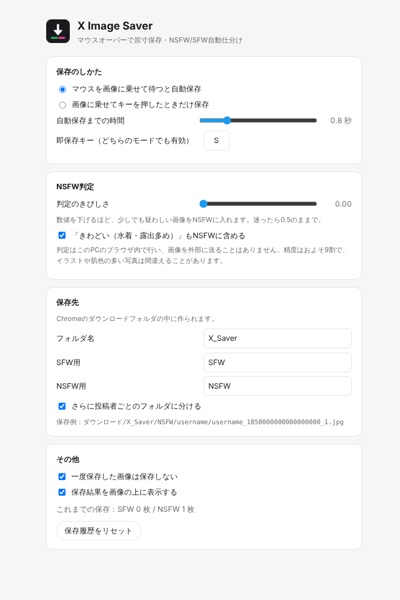

# X Image Saver

Xの画像にマウスを乗せるだけで原寸サイズを保存し、NSFW / SFW を自動で判定してフォルダ分けするChrome拡張機能です。

- **マウスオーバーで保存**：画像に乗せて0.8秒待つと保存（すぐ保存したいときは **S** キー）
- **原寸で保存**：`name=orig` の最大サイズを取得
- **NSFW / SFW 自動仕分け**：2つの判定モデルを組み合わせ、判定はPCのブラウザ内で行います（画像を外部に送信しません）
- **要確認フォルダ**：判定が微妙な画像は無理に振り分けず「要確認」へ
- **手直しと学習**：間違いはキー1つで直せて、直した結果からあなたの基準を覚えます。実際の正解率も表示します
- **X APIは使いません**：ログイン中の普段のブラウザ表示をそのまま使います



## インストール

1. このページ右上の **Code → Download ZIP** でダウンロードして解凍します
   （[Releases](../../releases) にzipがある場合はそちらでもOK）
2. Chromeで `chrome://extensions` を開きます
3. 右上の **デベロッパー モード** をオンにします
4. **パッケージ化されていない拡張機能を読み込む** を押して、解凍したフォルダの中の **`extension`** フォルダを選びます
5. Xのタブを開いている場合は再読み込みします

> Chromeの設定で「ダウンロード前に各ファイルの保存場所を確認する」がオンだと、毎回保存ダイアログが出ます。`chrome://settings/downloads` でオフにしてください。

## 使い方

| 操作 | 動作 |
|---|---|
| 画像にマウスを乗せて待つ | 右上にリングが出て、満タンになると保存 |
| 画像に乗せて **S** キー | すぐ保存 |
| 画像に乗せて **1** キー | SFWとして保存（保存済みならSFWに直す） |
| 画像に乗せて **2** キー | NSFWとして保存（保存済みならNSFWに直す） |
| 拡張機能のアイコンをクリック | 設定画面を開く（振り分けページへのリンクもここ） |

保存後、画像の左上に「保存 SFW」「保存 NSFW」と表示されます。一度保存した画像は二重に保存しません。

### 保存先

```
ダウンロード/X_Saver/SFW/ユーザー名_投稿ID_何枚目.jpg
ダウンロード/X_Saver/NSFW/ユーザー名_投稿ID_何枚目.jpg
ダウンロード/X_Saver/要確認/...     ← 判定が微妙なとき
ダウンロード/X_Saver/Unsorted/...   ← 判定に失敗したとき
```

設定で「投稿者ごとのフォルダに分ける」をオンにすると `X_Saver/NSFW/ユーザー名/...` になります。
引用ポスト内の画像など投稿IDが取れないときは `ユーザー名_画像ID.jpg` になります。

### 設定できること

- 自動保存までの時間 / キーを押したときだけ保存するモード
- 保存キー・SFWキー・NSFWキー
- NSFW判定のきびしさ、「要確認」にする幅、「きわどい（水着・露出多め）」をNSFWに含めるか
- 直した結果から学習するか
- 保存先のフォルダ名、投稿者ごとのフォルダ分け
- 保存履歴のリセット

## NSFW判定について

2つのオープンソースの判定モデルを拡張機能に同梱し、ブラウザ内で動かしています。

| モデル | 仕組み | 公表されている精度 |
|---|---|---|
| [Marqo nsfw-image-detection-384](https://huggingface.co/Marqo/nsfw-image-detection-384) | ViT（ONNX Runtime Web） | 98.56%（自前のテスト画像2万枚） |
| [NSFWJS](https://github.com/infinitered/nsfwjs)（MobileNetV2 Mid） | CNN（TensorFlow.js） | 約93% |

- 2つの結果を組み合わせ、X自身がセンシティブ指定している画像はそれだけでNSFWにします。
- 公表されている精度は、それぞれが用意したテスト画像での数字です。**あなたが見るXの画像で同じ精度が出るとは限りません**（特にアニメ調のイラスト）。
- そこで、実際の正解率を測って、上げる仕組みを入れています。
  1. **要確認フォルダ**：判定が五分五分の画像は「要確認」に入れます。幅を広げるほど、SFW/NSFWに振り分けた画像の精度は上がります。
  2. **手直し**：X上で画像に乗せて 1 / 2 キー、または振り分けページのボタンで直せます。ファイルも移動します。
  3. **学習**：確認・修正した画像が30枚以上たまると、あなたの基準に合わせた判定を作ります。交差検証で標準の判定より正確だと確かめられたときだけ使います。
  4. **実測の正解率**：設定画面に「確認した画像のうち何%が正しく振り分けられていたか」を表示します。
- 判定用には軽い `small` サイズの画像を使い、保存するのは原寸です。GPUがあれば WebGL、なければ WebAssembly で動きます（GPUなしでも1枚0.5秒ほど）。

## 既知の制限

- Xの画面構造が変わると反応しなくなることがあります。
- タイムラインにカーソルを置いたままゆっくりスクロールすると、カーソルの下を通った画像が保存されることがあります。気になる場合は「キーを押したときだけ保存」モードにしてください。
- 判定モデル（合わせて数十MB）はChromeを起動している間メモリに残ります。拡張機能のサイズは約45MBです。
- 動画・GIFには対応していません。

## 開発

```bash
npm install
npm run build      # src/offscreen-src.js → extension/offscreen.js ＋ WebAssembly をコピー
npm run model      # Marqo の重みを Hugging Face から取得して ONNX に変換（要 Python: torch, timm, onnx, onnxruntime）
npm run package    # ビルドして x-image-saver.zip を作る
```

`extension/offscreen.js` はビルド済みファイルですが、ZIPをダウンロードしてすぐ使えるようにリポジトリに含めています。`npm install` 後に `npm run build` すると同一のファイルが再生成されます。

### 構成

| ファイル | 役割 |
|---|---|
| `extension/content.js` | Xのページ上でホバーを検出し、画像情報を取り出す |
| `extension/background.js` | 受け取った情報を検証し、判定・ダウンロード・履歴管理を行う |
| `extension/offscreen.*` | 判定モデルを動かすオフスクリーン文書 |
| `extension/learn.js` | 判定の組み合わせ・学習（ロジスティック回帰）・評価 |
| `extension/options.*` | 設定画面 |
| `extension/review.*` | 振り分けページ |
| `extension/models/marqo/` | 変換済みの Marqo モデル |
| `src/offscreen-src.js` | `offscreen.js` のビルド元 |
| `tools/convert_marqo.py` | Marqo モデルの ONNX 変換と、変換結果の検証 |

### テスト

Xの画像まわりの構造を再現した疑似ページを、拡張機能を読み込んだ実際のChromiumで開いて検証します（Python + Playwright）。

```bash
pip install playwright
CHROME=/path/to/chrome xvfb-run python3 tests/smoke_test.py        # 基本動作
CHROME=/path/to/chrome xvfb-run python3 tests/adversarial_test.py  # 敵対的テスト（20項目）
CHROME=/path/to/chrome xvfb-run python3 tests/features_test.py     # 要確認・手直し・学習・振り分けページなど
```

敵対的テストでは、URLの細工によるパス挿入、引用ポストの取り違え、消えた画像の誤保存、同時連打、設定の書き込み上限、フォルダ名の細工、ページからのメッセージ送信などを確認しています。

## 注意

- 保存した画像の扱いは、各作者の権利とXの利用規約に従ってください。
- このツールはXおよびX Corp.とは関係ありません。

## ライセンス

[MIT](LICENSE)。同梱しているライブラリとモデルのライセンスは [THIRD_PARTY_NOTICES.md](THIRD_PARTY_NOTICES.md) を参照してください。
